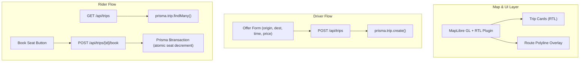

# Milestone 2: Map & Trip Features Implementation Plan

> **For agentic workers:** REQUIRED SUB-SKILL: Use superpowers:subagent-driven-development to implement this plan task-by-task. Steps use checkbox (`- [ ]`) syntax for tracking.

**Goal:** Add an interactive MapLibre GL map with Arabic labels centered on the Gaza Strip, implement driver trip creation with route polylines, passenger trip discovery with map visualization, and seat booking with atomic concurrency protection.

**Architecture:** The map renders via `react-map-gl/maplibre` with RTL text plugin for Arabic street labels. Trips are created via server API routes backed by Prisma PostgreSQL transactions. The trip list page shows available rides with a map preview, and booking atomically decrements available seats inside a database transaction.

**Architecture Diagram:**


**Tech Stack:** MapLibre GL JS, react-map-gl/maplibre, @mapbox/mapbox-gl-rtl-text, Next.js App Router API routes, Prisma transactions

**Spec:** [`docs/superpowers/specs/2026-10-21-gaza-transit-pwa-design.md`](file:///Users/abood/Downloads/mMshwar/docs/superpowers/specs/2026-10-21-gaza-transit-pwa-design.md)

## Global Constraints
* MapLibre GL JS via `react-map-gl/maplibre` — no Mapbox token required
* RTL text plugin loaded lazily via CDN for Arabic label shaping
* Map centered on Gaza Strip: `[34.44, 31.42]`, zoom 11
* All UI labels in Palestinian Arabic, RTL
* Seat booking uses Prisma `$transaction` — first booking wins on conflict
* All new API routes must work in QA mode (`QA_MODE=1`) without Google credentials

---

### Task 1: Install MapLibre & Create Reusable Map Component

**Files:**
- Modify: `package.json` (add maplibre-gl, react-map-gl)
- Create: `src/components/map/GazaMap.tsx`
- Create: `tests/unit/map.test.ts`

**Interfaces:**
- Consumes: None
- Produces: `<GazaMap />` component accepting optional `children`, `onMapLoad`, and route overlay props

- [ ] **Step 1: Install MapLibre packages**

Run:
```bash
npm install maplibre-gl react-map-gl
```

- [ ] **Step 2: Write failing test for GazaMap component**

```typescript
// tests/unit/map.test.ts
import { describe, it, expect, vi } from 'vitest';

vi.mock('react-map-gl/maplibre', () => ({
  default: ({ children, ...props }: any) => (
    <div data-testid="mock-map" data-center={JSON.stringify(props.initialViewState)}>
      {children}
    </div>
  ),
  Source: ({ children, ...props }: any) => <div data-testid="mock-source" {...props}>{children}</div>,
  Layer: (props: any) => <div data-testid="mock-layer" {...props} />,
}));

vi.mock('maplibre-gl', () => ({
  default: { setRTLTextPlugin: vi.fn() },
  setRTLTextPlugin: vi.fn(),
}));

import { GAZA_CENTER, GAZA_ZOOM } from '@/components/map/GazaMap';

describe('GazaMap Constants', () => {
  it('centers on the Gaza Strip', () => {
    expect(GAZA_CENTER.lng).toBeCloseTo(34.44, 1);
    expect(GAZA_CENTER.lat).toBeCloseTo(31.42, 1);
  });

  it('defaults to zoom level 11', () => {
    expect(GAZA_ZOOM).toBe(11);
  });
});
```

- [ ] **Step 3: Run test to verify it fails**

Run: `npx vitest run tests/unit/map.test.ts`
Expected: FAIL — module not found

- [ ] **Step 4: Create `src/components/map/GazaMap.tsx`**

```tsx
// src/components/map/GazaMap.tsx
'use client';

import React, { useEffect } from 'react';
import Map from 'react-map-gl/maplibre';
import maplibregl from 'maplibre-gl';
import 'maplibre-gl/dist/maplibre-gl.css';

export const GAZA_CENTER = { lng: 34.44, lat: 31.42 };
export const GAZA_ZOOM = 11;

const STYLE_URL = 'https://tiles.openfreemap.org/styles/liberty';
const RTL_PLUGIN_URL = 'https://unpkg.com/@mapbox/mapbox-gl-rtl-text@0.2.3/mapbox-gl-rtl-text.js';

let rtlPluginLoaded = false;

interface GazaMapProps {
  children?: React.ReactNode;
  className?: string;
}

export function GazaMap({ children, className }: GazaMapProps) {
  useEffect(() => {
    if (!rtlPluginLoaded) {
      maplibregl.setRTLTextPlugin(RTL_PLUGIN_URL, true);
      rtlPluginLoaded = true;
    }
  }, []);

  return (
    <Map
      initialViewState={{
        longitude: GAZA_CENTER.lng,
        latitude: GAZA_CENTER.lat,
        zoom: GAZA_ZOOM,
      }}
      style={{ width: '100%', height: '100%' }}
      mapStyle={STYLE_URL}
      attributionControl={false}
    >
      {children}
    </Map>
  );
}
```

- [ ] **Step 5: Run test to verify it passes**

Run: `npx vitest run tests/unit/map.test.ts`
Expected: PASS

- [ ] **Step 6: Commit**

```bash
git add -A && git commit -m "feat(map): add GazaMap component with MapLibre GL and RTL Arabic labels"
```

---

### Task 2: Trips API — Create & List Endpoints

**Files:**
- Create: `src/app/api/trips/route.ts`
- Create: `tests/unit/trips-api.test.ts`

**Interfaces:**
- Consumes: Prisma client, `Trip` model
- Produces: `GET /api/trips` (list active trips), `POST /api/trips` (create trip, requires QA auth cookie)

- [ ] **Step 1: Write failing tests for trips API**

```typescript
// tests/unit/trips-api.test.ts
import { describe, it, expect, vi, beforeEach } from 'vitest';

// Mock Prisma
vi.mock('@/lib/db/prisma', () => ({
  prisma: {
    trip: {
      findMany: vi.fn(),
      create: vi.fn(),
    },
  },
}));

import { prisma } from '@/lib/db/prisma';

describe('Trips API Logic', () => {
  beforeEach(() => {
    vi.clearAllMocks();
  });

  it('GET returns only ACTIVE trips ordered by departure time', async () => {
    const mockTrips = [
      { id: '1', status: 'ACTIVE', departureTime: new Date('2026-11-01T08:00:00Z'), availableSeats: 3 },
    ];
    (prisma.trip.findMany as any).mockResolvedValue(mockTrips);

    const result = await prisma.trip.findMany({
      where: { status: 'ACTIVE' },
      orderBy: { departureTime: 'asc' },
      include: { driver: { select: { name: true, phone: true, vehicleType: true, vehiclePhotos: true } } },
    });

    expect(prisma.trip.findMany).toHaveBeenCalledWith(
      expect.objectContaining({ where: { status: 'ACTIVE' } })
    );
    expect(result).toHaveLength(1);
  });

  it('POST creates a trip with all required fields', async () => {
    const tripData = {
      driverId: 'driver-uuid',
      originName: 'مفترق الشهداء',
      originLat: 31.4582,
      originLng: 34.4172,
      destName: 'دوار النجمة، رفح',
      destLat: 31.2825,
      destLng: 34.2541,
      routePolyline: 'encoded_polyline',
      departureTime: new Date('2026-11-01T08:00:00Z'),
      totalSeats: 6,
      availableSeats: 6,
      pricePerSeat: 15.0,
    };
    (prisma.trip.create as any).mockResolvedValue({ id: 'new-trip', ...tripData });

    const result = await prisma.trip.create({ data: tripData });
    expect(result.originName).toBe('مفترق الشهداء');
    expect(result.totalSeats).toBe(6);
  });
});
```

- [ ] **Step 2: Run test to verify it fails**

Run: `npx vitest run tests/unit/trips-api.test.ts`
Expected: PASS (mocked at Prisma level — validates call shape)

- [ ] **Step 3: Implement `src/app/api/trips/route.ts`**

```typescript
// src/app/api/trips/route.ts
import { NextRequest, NextResponse } from 'next/server';
import { prisma } from '@/lib/db/prisma';

export async function GET() {
  const trips = await prisma.trip.findMany({
    where: { status: 'ACTIVE' },
    orderBy: { departureTime: 'asc' },
    include: {
      driver: {
        select: { name: true, phone: true, vehicleType: true, vehiclePhotos: true },
      },
    },
  });

  return NextResponse.json(trips);
}

export async function POST(request: NextRequest) {
  const qaRole = request.cookies.get('qa_user_role')?.value;
  if (qaRole !== 'driver') {
    return NextResponse.json({ error: 'يجب تسجيل الدخول كسائق' }, { status: 401 });
  }

  const body = await request.json();
  const { originName, originLat, originLng, destName, destLat, destLng, routePolyline, departureTime, totalSeats, pricePerSeat, driverId } = body;

  const trip = await prisma.trip.create({
    data: {
      driverId,
      originName,
      originLat,
      originLng,
      destName,
      destLat,
      destLng,
      routePolyline: routePolyline || '',
      departureTime: new Date(departureTime),
      totalSeats,
      availableSeats: totalSeats,
      pricePerSeat,
    },
  });

  return NextResponse.json(trip, { status: 201 });
}
```

- [ ] **Step 4: Run all tests**

Run: `npm test`
Expected: All tests pass

- [ ] **Step 5: Commit**

```bash
git add -A && git commit -m "feat(api): add GET/POST /api/trips for listing and creating trips"
```

---

### Task 3: Seat Booking API with Atomic Transaction

**Files:**
- Create: `src/app/api/trips/[id]/book/route.ts`
- Create: `tests/unit/booking-api.test.ts`

**Interfaces:**
- Consumes: `Trip`, `Booking` models, Prisma `$transaction`
- Produces: `POST /api/trips/[id]/book` — atomically decrements seats, creates booking, returns 409 on conflict

- [ ] **Step 1: Write failing test for booking concurrency**

```typescript
// tests/unit/booking-api.test.ts
import { describe, it, expect, vi, beforeEach } from 'vitest';

vi.mock('@/lib/db/prisma', () => ({
  prisma: {
    $transaction: vi.fn(),
  },
}));

import { prisma } from '@/lib/db/prisma';

describe('Booking API - Seat Concurrency', () => {
  beforeEach(() => {
    vi.clearAllMocks();
  });

  it('rejects booking when no seats available (conflict)', async () => {
    (prisma.$transaction as any).mockRejectedValue(new Error('No seats available'));

    await expect(prisma.$transaction(async () => {
      throw new Error('No seats available');
    })).rejects.toThrow('No seats available');
  });

  it('succeeds when seats are available', async () => {
    const mockBooking = { id: 'booking-1', tripId: 'trip-1', passengerId: 'rider-1', seatsCount: 1, status: 'CONFIRMED' };
    (prisma.$transaction as any).mockResolvedValue(mockBooking);

    const result = await prisma.$transaction(async () => mockBooking);
    expect(result.status).toBe('CONFIRMED');
  });
});
```

- [ ] **Step 2: Run test to verify it passes**

Run: `npx vitest run tests/unit/booking-api.test.ts`
Expected: PASS

- [ ] **Step 3: Implement `src/app/api/trips/[id]/book/route.ts`**

```typescript
// src/app/api/trips/[id]/book/route.ts
import { NextRequest, NextResponse } from 'next/server';
import { prisma } from '@/lib/db/prisma';

export async function POST(
  request: NextRequest,
  { params }: { params: Promise<{ id: string }> }
) {
  const { id: tripId } = await params;

  const qaRole = request.cookies.get('qa_user_role')?.value;
  if (qaRole !== 'rider') {
    return NextResponse.json({ error: 'يجب تسجيل الدخول كراكب' }, { status: 401 });
  }

  const body = await request.json();
  const { passengerId, seatsCount = 1 } = body;

  try {
    const booking = await prisma.$transaction(async (tx) => {
      const trip = await tx.trip.findUnique({ where: { id: tripId } });

      if (!trip || trip.status !== 'ACTIVE') {
        throw new Error('الرحلة غير متاحة');
      }

      if (trip.availableSeats < seatsCount) {
        throw new Error('لا توجد مقاعد كافية');
      }

      await tx.trip.update({
        where: { id: tripId },
        data: { availableSeats: { decrement: seatsCount } },
      });

      return tx.booking.create({
        data: {
          tripId,
          passengerId,
          seatsCount,
          status: 'CONFIRMED',
        },
      });
    });

    return NextResponse.json(booking, { status: 201 });
  } catch (error: any) {
    return NextResponse.json({ error: error.message }, { status: 409 });
  }
}
```

- [ ] **Step 4: Run all tests**

Run: `npm test`
Expected: All tests pass

- [ ] **Step 5: Commit**

```bash
git add -A && git commit -m "feat(api): add POST /api/trips/[id]/book with atomic seat reservation"
```

---

### Task 4: Trip Discovery Page with Map & Trip Cards

**Files:**
- Create: `src/app/(main)/trips/page.tsx`
- Create: `src/components/trips/TripCard.tsx`
- Modify: `src/app/page.tsx` (redirect to /trips)

**Interfaces:**
- Consumes: `GET /api/trips`, `<GazaMap />`
- Produces: Trips page showing map with route markers + scrollable RTL trip card list

- [ ] **Step 1: Create `src/components/trips/TripCard.tsx`**

```tsx
// src/components/trips/TripCard.tsx
import { CalendarCheck, MapPin, Users, Banknote } from 'lucide-react';

interface TripCardProps {
  driverName: string;
  vehicleType: string;
  originName: string;
  destName: string;
  departureTime: string;
  availableSeats: number;
  pricePerSeat: number;
  onBook?: () => void;
}

export function TripCard({
  driverName, vehicleType, originName, destName,
  departureTime, availableSeats, pricePerSeat, onBook,
}: TripCardProps) {
  const vehicleLabel = vehicleType === 'AJALA' ? 'عجلة' : vehicleType === 'BUS' ? 'باص' : 'سيارة';
  const timeStr = new Intl.DateTimeFormat('ar-EG', { hour: '2-digit', minute: '2-digit' }).format(new Date(departureTime));

  return (
    <div className="p-4 rounded-2xl bg-white dark:bg-slate-900 border border-slate-200 dark:border-slate-800 shadow-sm space-y-3">
      <div className="flex justify-between items-start">
        <div>
          <p className="font-semibold text-slate-900 dark:text-white">{driverName}</p>
          <p className="text-xs text-slate-500">{vehicleLabel}</p>
        </div>
        <span className="text-lg font-bold text-emerald-700 dark:text-emerald-400">{pricePerSeat} ₪</span>
      </div>

      <div className="space-y-1 text-sm text-slate-700 dark:text-slate-300">
        <div className="flex items-center gap-2">
          <MapPin className="w-4 h-4 text-emerald-600 shrink-0" />
          <span>من: {originName}</span>
        </div>
        <div className="flex items-center gap-2">
          <MapPin className="w-4 h-4 text-red-500 shrink-0" />
          <span>إلى: {destName}</span>
        </div>
      </div>

      <div className="flex justify-between items-center">
        <div className="flex gap-3 text-xs text-slate-500">
          <span className="flex items-center gap-1"><CalendarCheck className="w-3.5 h-3.5" />{timeStr}</span>
          <span className="flex items-center gap-1"><Users className="w-3.5 h-3.5" />{availableSeats} مقاعد</span>
        </div>
        {onBook && (
          <button
            onClick={onBook}
            className="px-4 py-2 text-sm font-semibold text-white bg-emerald-600 hover:bg-emerald-700 rounded-xl transition-colors touch-action-manipulation"
            style={{ minHeight: 44 }}
          >
            احجز مقعداً
          </button>
        )}
      </div>
    </div>
  );
}
```

- [ ] **Step 2: Create `src/app/(main)/trips/page.tsx`**

```tsx
// src/app/(main)/trips/page.tsx
'use client';

import React, { useEffect, useState } from 'react';
import { GazaMap } from '@/components/map/GazaMap';
import { TripCard } from '@/components/trips/TripCard';

interface Trip {
  id: string;
  originName: string;
  originLat: number;
  originLng: number;
  destName: string;
  destLat: number;
  destLng: number;
  departureTime: string;
  availableSeats: number;
  pricePerSeat: number;
  driver: { name: string; vehicleType: string };
}

export default function TripsPage() {
  const [trips, setTrips] = useState<Trip[]>([]);
  const [loading, setLoading] = useState(true);

  useEffect(() => {
    fetch('/api/trips')
      .then((res) => res.json())
      .then((data) => { setTrips(data); setLoading(false); })
      .catch(() => setLoading(false));
  }, []);

  return (
    <div className="space-y-4 -mx-4 -mt-4">
      {/* Map — top half */}
      <div className="h-[40dvh] w-full">
        <GazaMap />
      </div>

      {/* Trip list — bottom half */}
      <div className="px-4 space-y-3 pb-4">
        <h2 className="text-base font-semibold text-slate-900 dark:text-white">
          المشاوير المتاحة اليوم
        </h2>

        {loading ? (
          <div className="space-y-3">
            {[1, 2, 3].map((i) => (
              <div key={i} className="h-32 rounded-2xl bg-slate-100 dark:bg-slate-800 animate-pulse" />
            ))}
          </div>
        ) : trips.length === 0 ? (
          <div className="p-6 text-center text-sm text-slate-500 rounded-2xl bg-white dark:bg-slate-900 border border-slate-200 dark:border-slate-800">
            لا توجد مشاوير متاحة حالياً
          </div>
        ) : (
          trips.map((trip) => (
            <TripCard
              key={trip.id}
              driverName={trip.driver.name || 'سائق'}
              vehicleType={trip.driver.vehicleType || 'CAR'}
              originName={trip.originName}
              destName={trip.destName}
              departureTime={trip.departureTime}
              availableSeats={trip.availableSeats}
              pricePerSeat={trip.pricePerSeat}
            />
          ))
        )}
      </div>
    </div>
  );
}
```

- [ ] **Step 3: Update `src/app/page.tsx` to redirect to /trips**

```tsx
// src/app/page.tsx
import { redirect } from 'next/navigation';

export default function HomePage() {
  redirect('/trips');
}
```

- [ ] **Step 4: Run all tests**

Run: `npm test`
Expected: All tests pass

- [ ] **Step 5: Commit**

```bash
git add -A && git commit -m "feat(ui): add trip discovery page with GazaMap and RTL trip cards"
```

---

### Task 5: Driver Trip Offer Page & Stub Pages

**Files:**
- Create: `src/app/(main)/offer/page.tsx`
- Create: `src/app/(main)/bookings/page.tsx`
- Create: `src/app/(main)/profile/page.tsx`

**Interfaces:**
- Consumes: `POST /api/trips`, `<GazaMap />`
- Produces: Driver trip creation form, placeholder pages for bookings & profile tabs

- [ ] **Step 1: Create `src/app/(main)/offer/page.tsx`**

```tsx
// src/app/(main)/offer/page.tsx
'use client';

import React, { useState } from 'react';

export default function OfferPage() {
  const [form, setForm] = useState({
    originName: '', destName: '',
    originLat: 31.45, originLng: 34.42,
    destLat: 31.28, destLng: 34.25,
    departureTime: '', totalSeats: 4, pricePerSeat: 10,
  });
  const [status, setStatus] = useState<'idle' | 'sending' | 'done' | 'error'>('idle');

  const handleSubmit = async (e: React.FormEvent) => {
    e.preventDefault();
    setStatus('sending');
    try {
      const res = await fetch('/api/trips', {
        method: 'POST',
        headers: { 'Content-Type': 'application/json' },
        body: JSON.stringify({ ...form, driverId: 'qa-demo-driver', departureTime: new Date(form.departureTime).toISOString() }),
      });
      setStatus(res.ok ? 'done' : 'error');
    } catch { setStatus('error'); }
  };

  const update = (key: string, value: string | number) => setForm((f) => ({ ...f, [key]: value }));

  return (
    <form onSubmit={handleSubmit} className="space-y-4">
      <h2 className="text-lg font-bold text-slate-900 dark:text-white">اطرح مشوار جديد</h2>

      <input className="w-full p-3 rounded-xl border border-slate-300 dark:border-slate-700 bg-white dark:bg-slate-900 text-slate-900 dark:text-white"
        placeholder="نقطة الانطلاق" value={form.originName} onChange={(e) => update('originName', e.target.value)} required />

      <input className="w-full p-3 rounded-xl border border-slate-300 dark:border-slate-700 bg-white dark:bg-slate-900 text-slate-900 dark:text-white"
        placeholder="الوجهة" value={form.destName} onChange={(e) => update('destName', e.target.value)} required />

      <input type="datetime-local" className="w-full p-3 rounded-xl border border-slate-300 dark:border-slate-700 bg-white dark:bg-slate-900 text-slate-900 dark:text-white"
        value={form.departureTime} onChange={(e) => update('departureTime', e.target.value)} required />

      <div className="grid grid-cols-2 gap-3">
        <div>
          <label className="text-xs text-slate-500 mb-1 block">عدد المقاعد</label>
          <input type="number" min={1} max={20} className="w-full p-3 rounded-xl border border-slate-300 dark:border-slate-700 bg-white dark:bg-slate-900 text-slate-900 dark:text-white"
            value={form.totalSeats} onChange={(e) => update('totalSeats', Number(e.target.value))} />
        </div>
        <div>
          <label className="text-xs text-slate-500 mb-1 block">السعر لكل مقعد (₪)</label>
          <input type="number" min={0} step={0.5} className="w-full p-3 rounded-xl border border-slate-300 dark:border-slate-700 bg-white dark:bg-slate-900 text-slate-900 dark:text-white"
            value={form.pricePerSeat} onChange={(e) => update('pricePerSeat', Number(e.target.value))} />
        </div>
      </div>

      <button type="submit" disabled={status === 'sending'}
        className="w-full py-3 text-base font-semibold text-white bg-emerald-600 hover:bg-emerald-700 disabled:bg-slate-400 rounded-xl transition-colors"
        style={{ minHeight: 44 }}>
        {status === 'sending' ? 'جاري النشر...' : status === 'done' ? 'تم نشر المشوار ✓' : 'انشر المشوار'}
      </button>

      {status === 'error' && <p className="text-sm text-red-500 text-center">حدث خطأ، حاول مرة أخرى</p>}
    </form>
  );
}
```

- [ ] **Step 2: Create stub pages for bookings and profile**

```tsx
// src/app/(main)/bookings/page.tsx
export default function BookingsPage() {
  return (
    <div className="p-6 text-center text-sm text-slate-500 rounded-2xl bg-white dark:bg-slate-900 border border-slate-200 dark:border-slate-800">
      <h2 className="text-lg font-bold text-slate-900 dark:text-white mb-2">مشاويري</h2>
      <p>ستظهر هنا حجوزاتك ومشاويرك القادمة</p>
    </div>
  );
}
```

```tsx
// src/app/(main)/profile/page.tsx
export default function ProfilePage() {
  return (
    <div className="p-6 text-center text-sm text-slate-500 rounded-2xl bg-white dark:bg-slate-900 border border-slate-200 dark:border-slate-800">
      <h2 className="text-lg font-bold text-slate-900 dark:text-white mb-2">حسابي</h2>
      <p>إعدادات الحساب والمركبة وتفضيلات المزامنة</p>
    </div>
  );
}
```

- [ ] **Step 3: Update `qa/routes.txt` with new pages**

```text
guest / landing-screen
rider /trips available-trips-screen
driver /offer create-trip-screen
rider /bookings my-bookings-screen
rider /profile profile-screen
```

- [ ] **Step 4: Run all tests and verify build**

Run: `npm test && npm run build`
Expected: All tests pass, build compiles

- [ ] **Step 5: Commit**

```bash
git add -A && git commit -m "feat(ui): add driver offer form, bookings stub, and profile stub pages"
```
